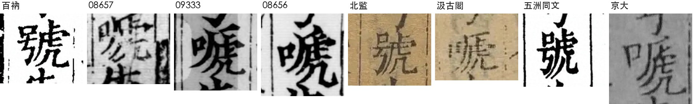
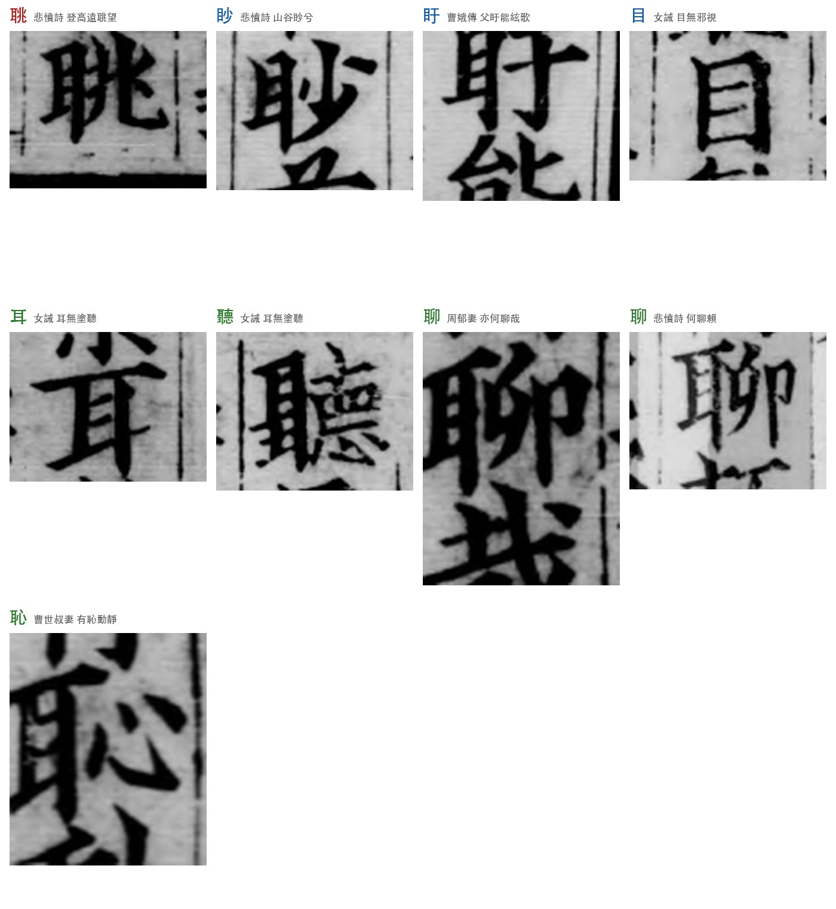
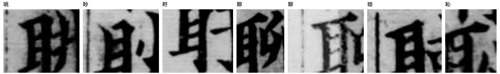
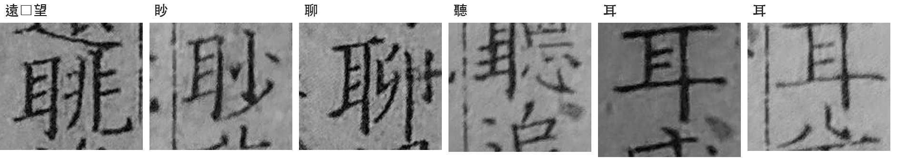
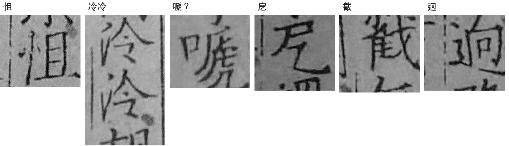

# 《悲愤诗》八本汇校：工作记录

> 2026-10-12—13（10-13 加入第八本京大藏本）。袁行远提出字表、判读字形、定取舍；Claude（千路会话 b0034877）截取影印、定位比对、整理记录。
> **逐字对照表：[八本對照.md](八本對照.md)**（35 处 × 8 本影印截图，GitHub 上直接看）。同样内容的单文件网页：[`悲憤詩八本對照.html`](悲憤詩八本對照.html)（下载后用浏览器打开）。

## 一、八个本子

左起大致按刊刻年代排，年代未定的京大藏本排最后。国图三本取自中华古籍资源库阅读器截图，百衲、北监、汲古阁、五洲同文取自识典古籍原图，京大藏本是袁行远用手机拍的影印本书页。

| 代号 | 本子 | 年代 | 行款 | 位置 | 出处 |
|---|---|---|---|---|---|
| bn | 百衲本 | 民国影印，通常著录为影宋绍兴本 | 九行十六字 | 第45—51页 | [识典 LS0003](https://www.shidianguji.com/book/LS0003/chapter/1j7lpp3blt8ai_251) |
| 09333 | 国图 09333 | 卷八十四配宋嘉定元年（1208）蔡琪一经堂本 | 八行十六字 | 第39册 第53—56页 | [国图](http://read.nlc.cn/OutOpenBook/OpenObjectBook?aid=892&bid=304498.0) |
| 08656 | 国图 08656 | 南宋白鹭洲书院本 | 八行十六字 | 第76册 第27—30页 | [国图](http://read.nlc.cn/OutOpenBook/OpenObjectBook?aid=892&bid=304783.0) |
| 08657 | 国图 08657 | 宋刻元修 | 十行十九字 | 第38册 第18—20页 | [国图](http://read.nlc.cn/OutOpenBook/OpenObjectBook?aid=892&bid=306947.0) |
| bj | 北监本 | 万历（1595—1606） | 十行二十一字 | 卷一百十四 | [识典 HY2027](https://www.shidianguji.com/book/HY2027/chapter/1knxmsomusumk) |
| jg | 汲古阁本 | 崇祯（1628—1644） | 十二行二十五字 | 列女传第七十四 | [识典 HY2998](https://www.shidianguji.com/book/HY2998/chapter/1kvp7vwfvos9x) |
| wz | 五洲同文本 | 光绪（1903），武英殿本系石印 | 十行二十一字 | 卷一百十四 | [识典 CADAL01027400](https://www.shidianguji.com/book/CADAL01027400/chapter/1l45dfz42a69g) |
| ky | 京大藏本 | 待核 | 每面十四至十五行，行二十六字 | 第374—376页 | 《日本京都大學藏珍稀漢籍十一種》册一六影印（纸本，袁行远拍照） |

两点注意：
- **09333 本身是拼配本**（北宋递修本为主，配黄善夫本、一经堂本）。说"09333 怎样"，严格说是"09333 所配一经堂本卷八十四怎样"。
- **京大藏本**：书页上印"日本京都大學藏珍稀漢籍十一種　册一六"，卷末题"後漢書列傳卷第七十四"。两面行数一为十五、一为十四，有界行。《点校本后汉书卷84勘误》称"京都本"，列为宋本；版本、年代待查原书解题。
- **百衲本是民国影印的配补本**，影印前有人工描润。卷八十四用的是哪个宋本，书前张元济跋和牌记还没核。它单独一家的细小笔画，可信度要打折扣。

## 二、字表与所见

字表 35 处：袁行远《怀忧复生诗》两张推荐表的字，原维基文库录错处，李贤注"㝠音瞑"，古诗文网错处。逐字对照见 [八本對照.md](八本對照.md)；截图文件在 `images/crops_mk/`（带红框）和 `images/crops/`（不带框），按 `<编号>_<代号>.jpg` 命名；总览见 `images/八本对照_1—4.jpg`。

### 有出入的七处

| 字 | 袁校高清版 | 百衲 | 08657 | 09333 | 08656 | 北监 | 汲古阁 | 五洲同文 | 京大 |
|---|---|---|---|---|---|---|---|---|---|
| 馬邊□男頭 | 縣 | 縣 | 縣 | 懸 | 懸 | 懸 | 懸 | 懸 | 懸 |
| 加□杖 | 捶 | 棰 | 棰 | 捶 | 捶 | 棰 | 棰 | 棰 | 捶 |
| □咤 | 怚 | 怛? | 怚 | 怚 | 怚 | 怚 | 怛? | 怛? | 怚 |
| 嗟薄□ | 祜 | 祐 | 祐 | 祐 | 祐 | 祐 | 祐 | 祐 | 祐 |
| 肅□□ | 泠泠 | 冷泠? | ? | 冷泠 | 冷泠 | 泠泠 | 冷泠? | 泠泠 | 泠泠 |
| □煢煢 | 徒 | 走 | 走 | 徒 | 徒 | 徒 | 走 | 徒 | 徒 |
| 兒呼母兮□失聲 | 嗁 | 號 | 嗁? | 嗁 | 嗁 | 號 | 嗁 | 號 | 嗁 |

"?" 是扫描分不清两点水和三点水、"且"和"旦"，待放大目验（`images/七本放大_已_怚.jpg`、`images/七本放大_冷泠.jpg`）。

"嗁"指口旁加虒（形近虎）的字，即"啼"的异体；08657 模糊。这一处加第八本时才看出来，之前把它算作各本相同，是看错了。袁校原作"號"，10-13 改从宋本作"嗁"（简体"啼"）。

其余各处八本相同：機、豈復、戹、窮、已（五洲同文一格不清）、匈、從、眺（京大本见第四节）、魂神、託、勗厲、牚、曼曼、顧、禽、寐、胡殿。𦍑、𢧵、逈、㝠 这类字形取自 09333，其余各本没有逐一核字形。

### 结论

1. **09333 仍是最好的底本。** 最早，和袁校一致的处数最多（捶、怚、徒），袁校用的古字形也都出自它。08656 与 09333 行款相同，其一部分逐栏起讫一样，这几处读法也全同。北监本也对三处（怚、泠泠、徒），但晚三百多年。
2. **袁校与 09333 的三处不同，各有来源：**
   - 縣：百衲本、08657 作"縣"。
   - 泠泠：八本中北监、五洲同文（明清官刻）和京大作"泠泠"，宋本都作"冷泠"。
   - 祜：八本全作"祐"。"祜"出自明代冯惟讷《古诗纪》，经沈钦韩、王先谦到中华书局点校本。
   - 仓库内部待统一：《点校本后汉书卷84勘误》第六节说唱和互校支持"祐"，《怀忧复生诗》两版写"祜"。
3. **徒/走不按年代一刀切。** 作"走"：百衲本、08657、汲古阁本；作"徒"：09333、08656、北监本、五洲同文本、京大藏本。明清两大官刻都作"徒"。
4. **縣/懸**：只有百衲本和 08657 作"縣"。
5. **京大藏本**在懸、捶、怚、祐、徒五处与 09333 全同；"肅□□"作"泠泠"，同北监、五洲同文。判据（袁行远）：左旁点下那一笔从中间起、先下后上，是三点水的点和提连写；两点水的提是从下往上一笔。我起初误读成"冷冷"。
6. **號/嗁**：宋本 09333、08656（08657 模糊，似也是）和汲古阁、京大作"嗁"（口旁加虒，虒比虎多左边一道长撇；嗁即啼），百衲、北监、五洲同文作"號"。
   - 《怀忧复生诗》推荐表原说"自宋本至中华书局版，所有权威版本皆作號"，与此不合：两个国图宋本都是"嗁"。已改。
   - 百衲本作"號"，但它影印前经过描润，可能被改过；中华书局点校本承百衲本，也作"號"，《点校本后汉书卷84勘误》已补为错误一条。
   - 取"嗁"的理由：宋本二比〇（加汲古阁、京都本）；生僻字被换成常用字常见，反向少见；《说文》"嗁，號也""號，呼也"，作"號"与上文"呼"义重。估计范晔原文作"嗁"约 0.85，蔡琰用的词是"嗁/啼"约 0.78。
   - 古诗文网作"啼"，原来是对的；10-12 的纠错信里不该算它的错，等对方回信后再说明。

## 三、眺，不是聎

09333"登高遠□望"那个字，左旁的右竖在下端伸出提画，乍看像耳旁，一度录作"聎"。拿同卷（一经堂本卷八十四）确定的目旁、耳旁来对：

- **下端**：目旁、耳旁的右竖都伸出提画之下，分不开。
- **右上角**：耳旁首横向右穿出右竖，即聊（周郁妻"亦何聊哉"，第32页；悲愤诗"何聊賴"，第55页）、聽（女诫"耳無塗聽"，第39页）、恥（曹世叔妻"有恥動靜"，第38页）。目旁是横折封口，即眇（"山谷眇兮"，第55页）、盱（曹娥传"父盱能絃歌"，第44页）。
- 此字右上封口，是**眺**。

判据是袁行远看出的："耳能清楚看到右上出头，而眺望那里没有出头。"Claude 起初把判据说成"目旁耳旁同形"，不对，已改。

## 四、京大藏本的"遠□望"

- 依次：遠□望、眇；聊、聽、耳、耳。
- 下端：这个本子的目旁、耳旁底横都向左伸出，分不开（"眇"也这样）。
- 右上角：聊、聽首横明显穿出右竖；"遠□望"那字和"眇"一样，大致齐平，只略微冒头。
- 按 09333 的判据倾向"眺"，但不如 09333 清楚。

京大藏本另几处字形（怚、泠泠、嗁、戹、截、迥）：

## 五、相关改动

- 本仓库：`42a101a` 聎→眺（怀忧复生诗、辨音续弦、点校本勘误撤一条、发现备忘、绿皮录文）；`405b7d4` 改正判别理由。
- 维基文库《悲憤詩 (蔡琰)》：聎→眺，不出校记（袁行远定："说不定专家看来是常识"）。
- 古诗文网：10-12 纠错信曾请改"聎"，要补一封更正，说明"眺"不必改。

## 六、做法与限度

- 定位：每本先读出每栏栏首字作锚点（`tools/cfg/cfg_<代号>.json` 的 `cols`），栏内按格均分，再用墨迹峰值拟合每栏中线（`tools/colcenters.py`）。红框偶尔偏小半格，以上下文为准。
- 截图：国图用 `tools/nshot.py`（CDP 驱动阅读器翻页截屏）；识典用 `tools/sdpages.py`（点翻页、收集签名图片地址、带 Referer 下载）。
- 出图：`tools/layout.py <代号>` 生成截图；`tools/build.py` + `tools/tpl.html` 生成网页数据；`tools/gen_cmp.py`、`cmp9333.py`、`topright.py` 生成目旁/耳旁对照。`tools/bf_now.wiki` 是定位用的 09333 录文。
- 京大藏本是照片，有透视变形和书页弯曲，没法用整页网格：先手工读出每栏顶、底两处的中线位置和文字起止，按栏内字数（小注按约 0.62 字高）均分，个别偏一格的手工校正（`tools/v8/lay8.py`、`tools/v8/adj.json`）。`tools/gen_md.py` 生成八本對照.md，`tools/ov8.py` 生成总览图。
- 脚本里的路径是当时工作目录（`~/.claude/jobs/b0034877/tmp/hj/`）的绝对路径，复用时要改。原始整页影印没有收进仓库（版权与体积），按上表出处可重新取得。
- 中华书局点校本有版权，没有收进对照。

## 七、待办

- 坐实百衲本《後漢書》卷八十四的底本（第一册牌记、张元济跋）。
- 放大目验表中"?"各格。
- 京大藏本：查原书解题，定版本与年代。
- 统一"祐/祜"。
