# 《悲憤詩》七本對照

《後漢書·列女傳·董祀妻》蔡琰《悲憤詩》關鍵字，七個本子的影印截圖逐字對照。每行一個字，每列一個本子，從左到右大致按刊刻年代排。紅框是要看的字，上下各留一字。點圖看不帶紅框的大圖。表頭點本子名去原書。

結論、判據和做法見 [README](README.md)；09333 同卷目旁與耳旁的比對見 README 第三節。

## 其一（五言）

| 字 | [百衲本](https://www.shidianguji.com/book/LS0003/chapter/1j7lpp3blt8ai_251) 影宋紹興本 九行十六字 | [國圖 09333](http://read.nlc.cn/OutOpenBook/OpenObjectBook?aid=892&bid=304498.0) 嘉定元年（1208） 八行十六字 | [國圖 08656](http://read.nlc.cn/OutOpenBook/OpenObjectBook?aid=892&bid=304783.0) 南宋 白鷺洲書院 八行十六字 | [國圖 08657](http://read.nlc.cn/OutOpenBook/OpenObjectBook?aid=892&bid=306947.0) 宋刻元修 十行十九字 | [北監本](https://www.shidianguji.com/book/HY2027/chapter/1knxmsomusumk) 萬曆（1595—1606） 十行二十一字 | [汲古閣本](https://www.shidianguji.com/book/HY2998/chapter/1kvp7vwfvos9x) 崇禎（1628—1644） 十二行二十五字 | [五洲同文本](https://www.shidianguji.com/book/CADAL01027400/chapter/1l45dfz42a69g) 光緒（1903） 十行二十一字 |
|---|---|---|---|---|---|---|---|
| 皆胡**𦍑**獵野 𦍑（羊下作人）/ 羌 a01 | <a href="images/crops/a01_bn.jpg">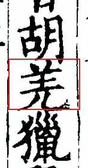</a> | <a href="images/crops/a01_09333.jpg">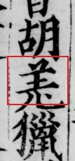</a> | <a href="images/crops/a01_08656.jpg">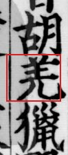</a> | <a href="images/crops/a01_08657.jpg">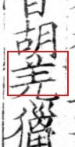</a> | <a href="images/crops/a01_bj.jpg">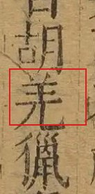</a> | <a href="images/crops/a01_jg.jpg">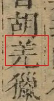</a> | <a href="images/crops/a01_wz.jpg">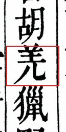</a> |
| 亡斬**𢧵**無孑 𢧵（左雀右戈）/ 截 a02 | <a href="images/crops/a02_bn.jpg">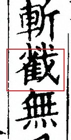</a> | <a href="images/crops/a02_09333.jpg">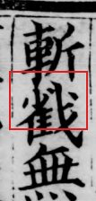</a> | <a href="images/crops/a02_08656.jpg">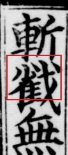</a> | <a href="images/crops/a02_08657.jpg">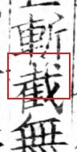</a> | <a href="images/crops/a02_bj.jpg">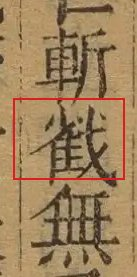</a> | <a href="images/crops/a02_jg.jpg">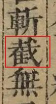</a> | <a href="images/crops/a02_wz.jpg">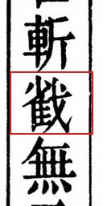</a> |
| 骸相**牚**拒牚 牚 / 撐 a03 | <a href="images/crops/a03_bn.jpg">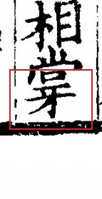</a> | <a href="images/crops/a03_09333.jpg">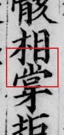</a> | <a href="images/crops/a03_08656.jpg">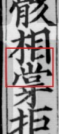</a> | <a href="images/crops/a03_08657.jpg">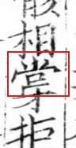</a> | <a href="images/crops/a03_bj.jpg">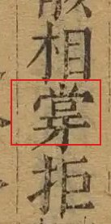</a> | <a href="images/crops/a03_jg.jpg">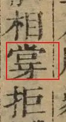</a> | <a href="images/crops/a03_wz.jpg">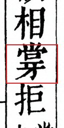</a> |
| 馬邊**懸**男頭 懸 / 縣 a04 | <a href="images/crops/a04_bn.jpg">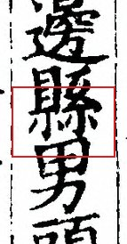</a> | <a href="images/crops/a04_09333.jpg">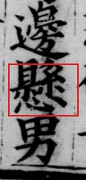</a> | <a href="images/crops/a04_08656.jpg">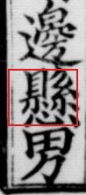</a> | <a href="images/crops/a04_08657.jpg">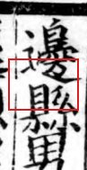</a> | <a href="images/crops/a04_bj.jpg">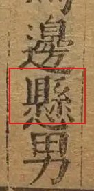</a> | <a href="images/crops/a04_jg.jpg">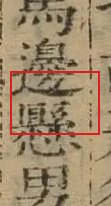</a> | <a href="images/crops/a04_wz.jpg">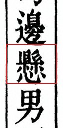</a> |
| 入關**逈**路險 逈 / 迥 a05 | <a href="images/crops/a05_bn.jpg">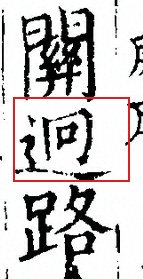</a> | <a href="images/crops/a05_09333.jpg">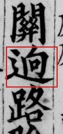</a> | <a href="images/crops/a05_08656.jpg">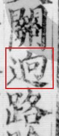</a> | <a href="images/crops/a05_08657.jpg">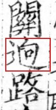</a> | <a href="images/crops/a05_bj.jpg">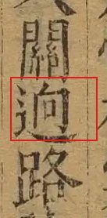</a> | <a href="images/crops/a05_jg.jpg">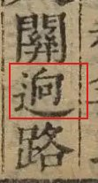</a> | <a href="images/crops/a05_wz.jpg">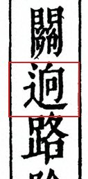</a> |
| 顧邈**㝠㝠**肝脾 㝠 / 冥 a06 | <a href="images/crops/a06_bn.jpg">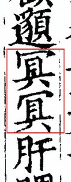</a> | <a href="images/crops/a06_09333.jpg">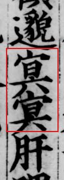</a> | <a href="images/crops/a06_08656.jpg">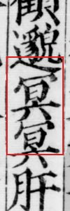</a> | <a href="images/crops/a06_08657.jpg">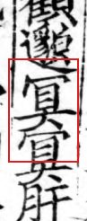</a> | <a href="images/crops/a06_bj.jpg">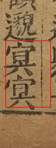</a> | <a href="images/crops/a06_jg.jpg">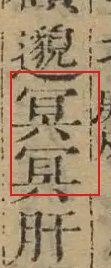</a> | <a href="images/crops/a06_wz.jpg">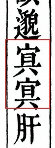</a> |
| 失意**機**微間 機 / 幾 a07 | <a href="images/crops/a07_bn.jpg">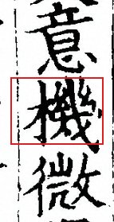</a> | <a href="images/crops/a07_09333.jpg">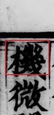</a> | <a href="images/crops/a07_08656.jpg">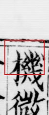</a> | <a href="images/crops/a07_08657.jpg">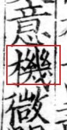</a> | <a href="images/crops/a07_bj.jpg">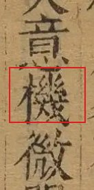</a> | <a href="images/crops/a07_jg.jpg">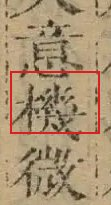</a> | <a href="images/crops/a07_wz.jpg">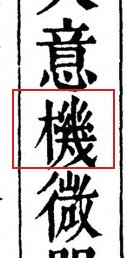</a> |
| 便加**捶**杖毒 捶 / 棰 a08 | <a href="images/crops/a08_bn.jpg">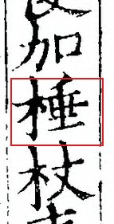</a> |  |  |  |  |  |  |
| 汝豈**復**惜性 a09 |  |  |  |  |  |  |  |
| 遭此**戹**禍邊 戹 / 厄 a10 |  |  |  |  |  |  |  |
| 歎無**窮**已有 a11 |  |  |  |  |  |  |  |
| 迎己**已**得自 已 / 己 a12 |  |  |  |  |  |  |  |
| 送告**離別**慕我 a13 |  |  |  |  |  |  |  |
| 腹子**匈**臆爲 匈 / 胸 a14 |  |  |  |  |  |  |  |
| 知誰**從**橫莫 從 / 縱 a15 |  |  |  |  |  |  |  |
| 孤景**怚咤糜**肝肺 怚 / 怛 a16 |  |  |  |  |  |  |  |
| 高遠**聎**望魂 眺（右上封口是目旁，似聎） a17 |  |  |  |  |  |  |  |
| 聎望**魂神**忽飛 a18 |  |  |  |  |  |  |  |
| 聊賴**託**命於 託 / 托 a19 |  |  |  |  |  |  |  |
| 心自**勗厲**流離 勗 / 勖，厲 / 勵 a20 |  |  |  |  |  |  |  |

## 其二（騷體）

| 字 | [百衲本](https://www.shidianguji.com/book/LS0003/chapter/1j7lpp3blt8ai_251) 影宋紹興本 九行十六字 | [國圖 09333](http://read.nlc.cn/OutOpenBook/OpenObjectBook?aid=892&bid=304498.0) 嘉定元年（1208） 八行十六字 | [國圖 08656](http://read.nlc.cn/OutOpenBook/OpenObjectBook?aid=892&bid=304783.0) 南宋 白鷺洲書院 八行十六字 | [國圖 08657](http://read.nlc.cn/OutOpenBook/OpenObjectBook?aid=892&bid=306947.0) 宋刻元修 十行十九字 | [北監本](https://www.shidianguji.com/book/HY2027/chapter/1knxmsomusumk) 萬曆（1595—1606） 十行二十一字 | [汲古閣本](https://www.shidianguji.com/book/HY2998/chapter/1kvp7vwfvos9x) 崇禎（1628—1644） 十二行二十五字 | [五洲同文本](https://www.shidianguji.com/book/CADAL01027400/chapter/1l45dfz42a69g) 光緒（1903） 十行二十一字 |
|---|---|---|---|---|---|---|---|
| 嗟薄**祐**兮遭 祐 / 祜 b01 |  |  |  |  |  |  |  |
| 兮路**曼曼**眷東 b02 |  |  |  |  |  |  |  |
| 眷東**顧**兮但 b03 |  |  |  |  |  |  |  |
| 悲歎**㝠**當寢 㝠 / 冥 b04 |  |  |  |  |  |  |  |
| 能安**㝠音瞑**飢當 李賢注：瞑 / 䏃 b05 |  |  |  |  |  |  |  |
| 人似**禽**兮食 b06 |  |  |  |  |  |  |  |
| 之貌**歳**聿暮 歳 / 歲 b07 |  |  |  |  |  |  |  |
| 禁門**扄**不能 扄 / 扃 b08 |  |  |  |  |  |  |  |
| 不能**寐**兮起 b09 |  |  |  |  |  |  |  |
| 營登**胡**殿兮 胡 / 明 b10 |  |  |  |  |  |  |  |
| 兮肅**冷泠**胡笳 冷泠 / 泠泠 b11 |  |  |  |  |  |  |  |
| 思兮**匈**憤盈 匈 / 胸 b12 |  |  |  |  |  |  |  |
| 母兮**號**失聲 號 / 啼 b13 |  |  |  |  |  |  |  |
| 聲我**掩**耳兮 耳 / 目 b14 |  |  |  |  |  |  |  |
| 我兮**徒**煢煢 徒 / 走 b15 |  |  |  |  |  |  |  |

---

截圖方法、定位誤差與各本出處見 [README](README.md)。國圖三本取自中華古籍資源庫，其餘取自識典古籍。